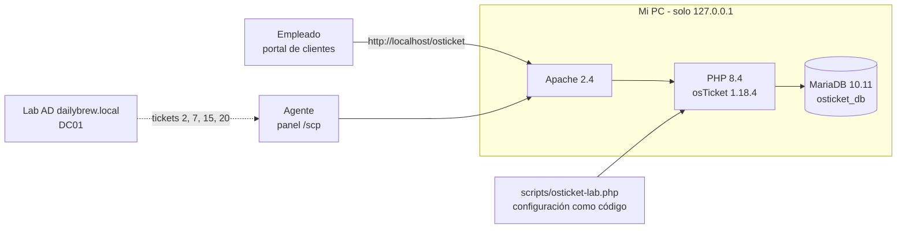
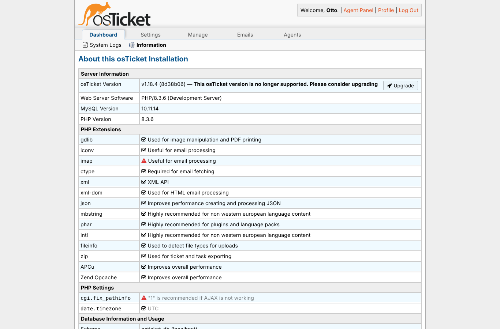
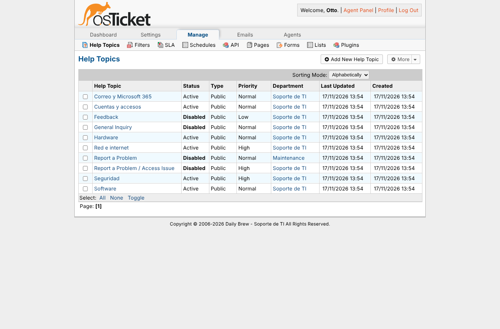
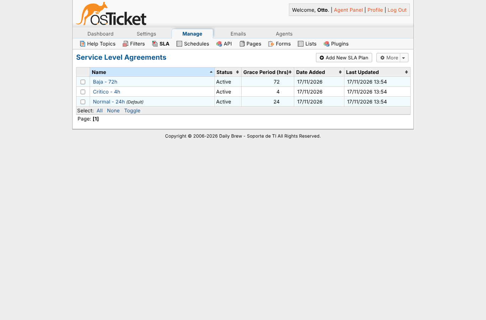
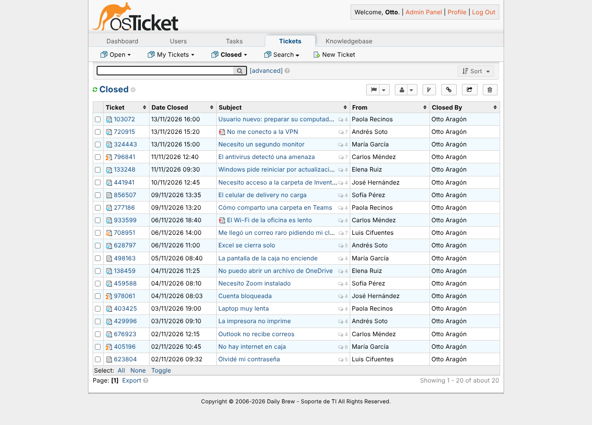
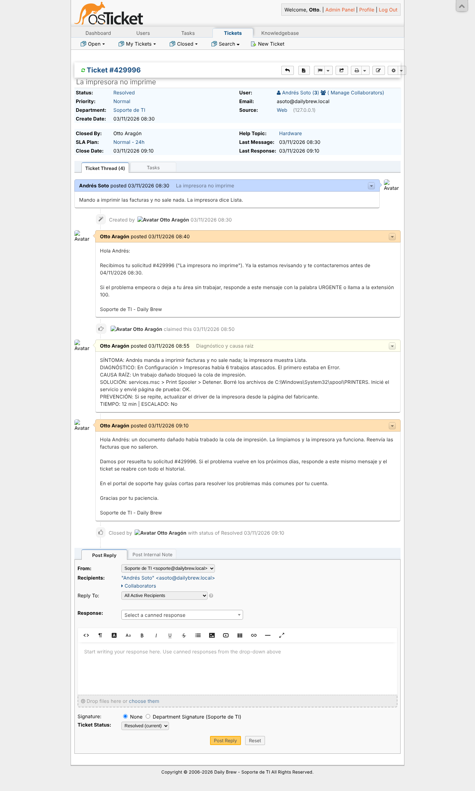
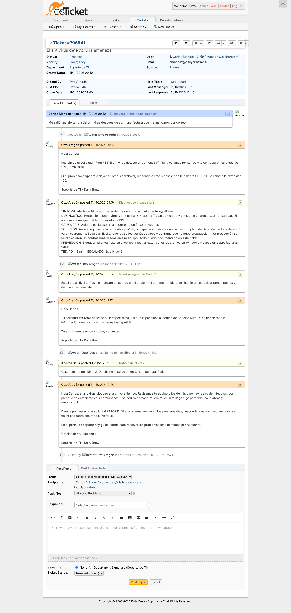
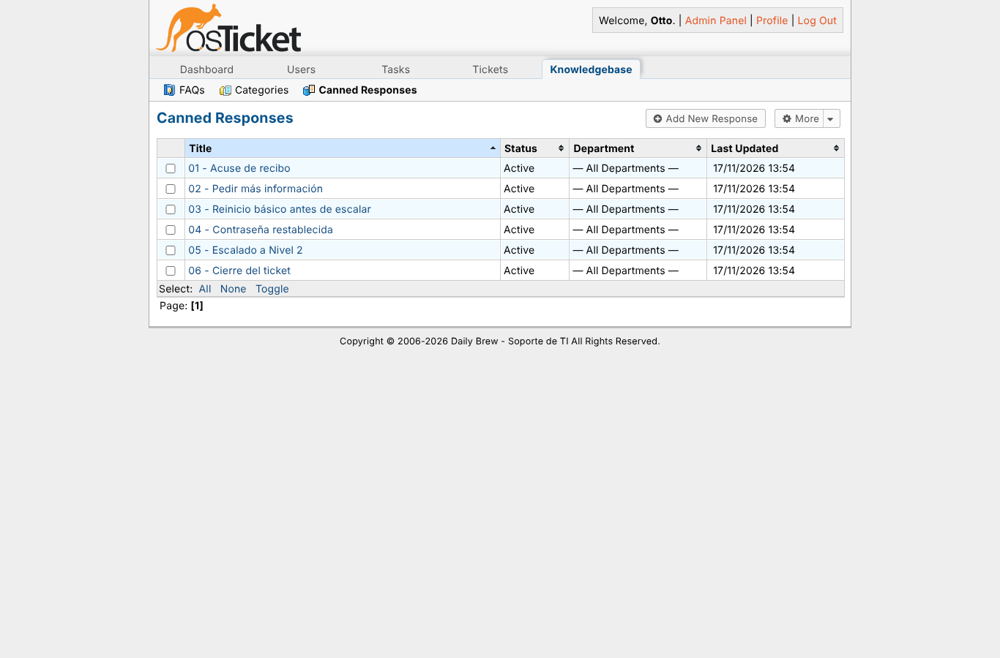
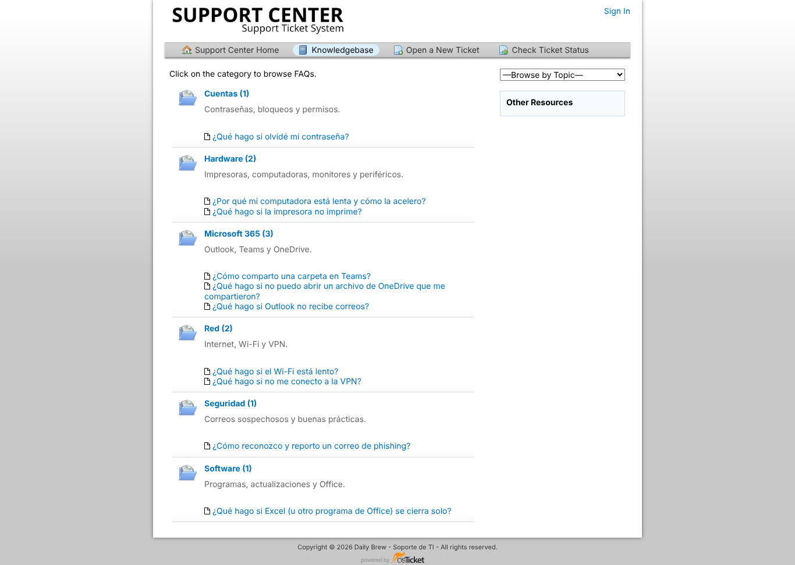
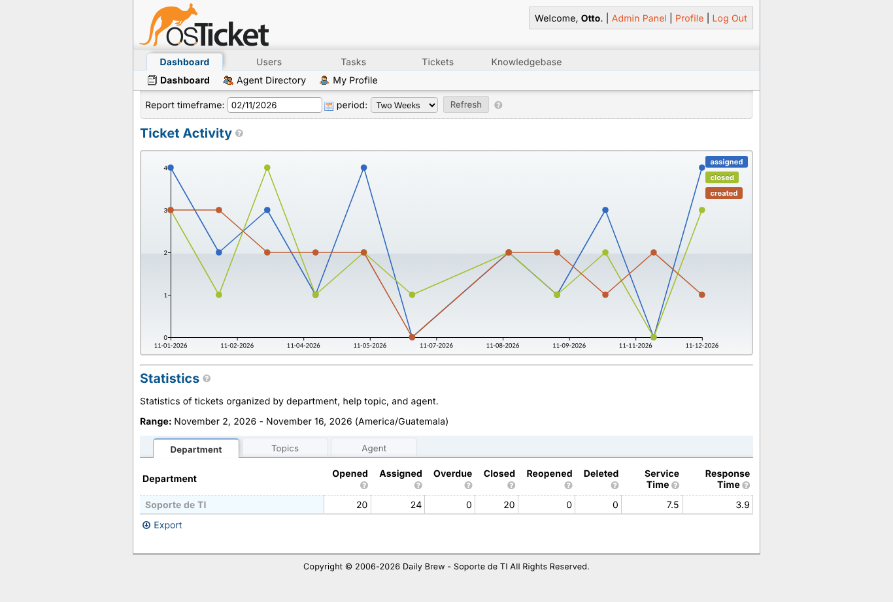

# Help desk de TI con osTicket: Daily Brew

Mesa de ayuda completa para el soporte de TI ficticio de una cafetería (Daily Brew), montada con **osTicket 1.18.4** sobre XAMPP en Windows y operada como si fuera real: departamento, dos niveles de soporte, planes de SLA, 20 incidentes resueltos y documentados con causa raíz, 4 escalados, 10 artículos de base de conocimiento y métricas del periodo.

Es la segunda parte de mi portafolio de soporte. Los usuarios y los tickets de cuentas se apoyan en el [laboratorio de Active Directory](https://github.com/Ottoa6517/lab-active-directory-dailybrew) (dominio `dailybrew.local`).

| Elemento | Valor |
|---|---|
| Sistema de tickets | osTicket 1.18.4 (versión con los últimos parches de seguridad, SHA-256 verificado) |
| Servidor | XAMPP 8.4.27: Apache 2.4, PHP 8.4, MariaDB 10.11, solo en `127.0.0.1` |
| Departamento | Soporte de TI, con equipos **Nivel 1** y **Nivel 2** |
| Planes de SLA | Crítico 4 h · Normal 24 h · Baja 72 h |
| Temas de ayuda | Hardware, Software, Red e internet, Cuentas y accesos, Correo y Microsoft 365, Seguridad |
| Resultado | 20 tickets resueltos, 90 % dentro del SLA, 4 escalados, 10 artículos publicados |

> **Todo es ficticio.** Usuarios, correos `@dailybrew.local` y tickets son inventados. Las fechas de los tickets se repartieron en dos semanas laborales (2 al 13 de noviembre de 2026) para que el dashboard y los SLA tengan sentido; está explicado en [metricas.md](metricas.md).

## Arquitectura



## Cómo lo construí

### 1. Instalación segura

XAMPP viene pensado para desarrollo: root de MariaDB sin contraseña y servicios abiertos a toda la red. Antes de instalar osTicket lo aseguré con [`02-preparar-xampp.ps1`](scripts/windows/02-preparar-xampp.ps1): Apache y MariaDB solo en `127.0.0.1`, root con contraseña, usuario de base de datos con permisos solo sobre `osticket_db`, y `php.ini` con los ajustes de la hoja de configuración PHP de OWASP. [`03-instalar-osticket.ps1`](scripts/windows/03-instalar-osticket.ps1) descarga osTicket, **verifica su SHA-256**, corre el instalador, borra `setup/` y deja `ost-config.php` en solo lectura.

Al probar la guía original encontré 12 cosas que cambiar; la más importante: la primera descarga que ofrece hoy apachefriends.org es XAMPP con **PHP 8.5**, y osTicket 1.18.4 solo admite PHP 8.2 a 8.4. Están todas en [docs/02-instalacion.md](docs/02-instalacion.md).



### 2. Configuración como código

Toda la configuración está en archivos JSON ([`scripts/datos/`](scripts/datos)) y la aplica [`osticket-lab.php`](scripts/osticket-lab.php) usando las clases internas de osTicket, con las mismas validaciones que el panel de administración. Cada fase se puede repetir sin duplicar nada.

| Fase | Qué hace |
|---|---|
| `configurar` | Zona horaria, formato de fecha, alertas de correo apagadas, registro privado, CAPTCHA, departamento, agente de Nivel 2, equipos, 3 SLA, 6 temas, 6 respuestas predefinidas, portal en español, 6 categorías de KB |
| `usuarios` | 8 usuarios ficticios ligados a sus cuentas del dominio |
| `tickets` | 20 tickets: 13 por el portal y 7 registrados por el agente (teléfono, correo, en persona) |
| `resolver` | Asignar > acuse de recibo > nota interna > escalar > responder > Resolved |
| `kb` | Publica los 10 artículos de `base-de-conocimiento/` |
| `cronologia` | Reparte las fechas en dos semanas (simulación declarada) |
| `metricas` | Calcula los indicadores desde la base y escribe `metricas.md` |





### 3. Los 20 tickets

Cubren hardware, software, red, Active Directory, Microsoft 365 y seguridad. Cada uno tiene su nota interna con síntoma, diagnóstico, causa raíz, solución, prevención y tiempo: [tickets/](tickets/README.md).



Ticket completo, con el hilo que ve el usuario y la nota interna que no ve:



### 4. Escalamiento a Nivel 2

Escalé 4 tickets (1, 12, 17 y 18), siempre con el motivo por escrito. En osTicket los equipos se **asignan**; "transferir" es solo entre departamentos. El ticket 17 (malware) tiene además un [postmortem sin culpables](docs/postmortem-ticket-17.md).



### 5. Respuestas predefinidas

Seis plantillas con variables de osTicket (`%{ticket.name.first}`, `%{ticket.number}`, `%{ticket.due_date}`).



### 6. Base de conocimiento

Diez artículos para usuarios no técnicos, con el título como pregunta, pasos numerados y cuándo pedir ayuda: [base-de-conocimiento/](base-de-conocimiento).



### 7. Métricas

| Indicador | Valor |
|---|---|
| Cumplimiento de SLA | 18 de 20 (90 %) |
| Escalados a Nivel 2 | 4 (20 %) |
| Resueltos al primer contacto | 15 (75 %) |
| Primera respuesta promedio | 17 min |

Conclusiones y detalle por ticket en [metricas.md](metricas.md).



## Seguridad

Resumen en [docs/03-seguridad.md](docs/03-seguridad.md): versión parcheada contra CVE-2026-22200 y CVE-2025-26241, servicios solo en localhost, mínimo privilegio en la base de datos y en los agentes, PHP endurecido, contraseñas que nunca tocan un archivo y lo que haría distinto en producción.

## Reproducirlo

```powershell
# PowerShell como administrador, en la carpeta del repositorio, con XAMPP 8.4.27 instalado en C:\xampp
powershell -ExecutionPolicy Bypass -File .\scripts\windows\01-verificar-entorno.ps1
powershell -ExecutionPolicy Bypass -File .\scripts\windows\02-preparar-xampp.ps1
powershell -ExecutionPolicy Bypass -File .\scripts\windows\03-instalar-osticket.ps1 -Nombre Otto -Apellido "Aragón" -Correo otto.admin@dailybrew.local
powershell -ExecutionPolicy Bypass -File .\scripts\windows\05-cargar-laboratorio.ps1 -Fase todo
python scripts\capturas.py --usuario otto.admin      # opcional: regenera las capturas
```

## Estructura

```
helpdesk-osticket-lab/
  README.md
  metricas.md                 indicadores y 3 conclusiones
  base-de-conocimiento/       10 artículos en Markdown
  tickets/                    los 20 tickets con su nota interna
  capturas/                   evidencias
  docs/                       instalación, seguridad, operación, mantenimiento, postmortem
  scripts/
    osticket-lab.php          configuración y carga del laboratorio
    datos/                    configuración, usuarios, tickets y respuestas (JSON)
    windows/                  verificación, hardening, instalación, respaldo
    ad/                       tickets 2, 7, 15 y 20 hechos en el dominio real
    capturas.py               capturas automáticas con Playwright
    generar-docs.php          genera tickets/ desde los datos
```

## Problemas encontrados y cómo se resolvieron

| Problema | Causa | Solución |
|---|---|---|
| La descarga por defecto de XAMPP trae PHP 8.5 | XAMPP 8.5.12 salió el 23/10/2026; osTicket 1.18.4 solo admite 8.2 a 8.4 | Instalar XAMPP 8.4.27 y comprobar la versión con `01-verificar-entorno.ps1` |
| "Valid email is required" al crear el agente de Nivel 2 | osTicket verifica que el dominio del correo exista en DNS y `.local` no existe | Desactivar *Verify Email Addresses* |
| Los formatos de fecha `dd/MM/y` no se aplicaban | Solo se usan si *Date and Time Format* está en *Custom* | Ajuste `date_formats = custom` |
| La base de conocimiento no aparecía en el portal | Viene desactivada por defecto | *Enable Knowledge Base* |
| Las métricas salían en 0 al correr todo junto | El ORM de osTicket guardaba en caché las fechas anteriores a la fase `cronologia` | Leer las fechas directo de la base con SQL |

## Línea para el CV

> Implementé y aseguré un help desk con osTicket 1.18 (Apache, PHP 8.4, MariaDB): configuré SLA por prioridad, temas de ayuda y escalamiento en dos niveles; resolví y documenté 20 incidentes de hardware, red, Active Directory, Microsoft 365 y seguridad con causa raíz (90 % dentro del SLA) y publiqué 10 artículos de autoayuda. Automaticé la instalación y la configuración con PowerShell y PHP.
