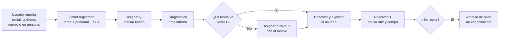

# Cómo opera el help desk

El flujo sigue la práctica de gestión de incidentes de ITIL 4: registrar, clasificar, priorizar, diagnosticar, escalar si hace falta, resolver, cerrar y documentar.



## Prioridad: impacto por urgencia

El tema de ayuda pone un SLA por defecto. El agente lo ajusta con esta matriz:

| | Urgencia alta (no puede trabajar) | Urgencia media (trabaja con dificultad) | Urgencia baja (puede esperar) |
|---|---|---|---|
| **Impacto alto** (toda una área o la caja) | Emergency · Crítico 4 h | High · Normal 24 h | Normal · Normal 24 h |
| **Impacto medio** (una persona clave) | High · Normal 24 h | Normal · Normal 24 h | Low · Baja 72 h |
| **Impacto bajo** (una persona, hay alternativa) | Normal · Normal 24 h | Low · Baja 72 h | Low · Baja 72 h |

Cualquier sospecha de seguridad (phishing con clic, malware, cuenta usada desde un equipo ajeno) entra como **Seguridad** con SLA **Crítico 4 h**, aunque afecte a una sola persona.

## Cuándo escalar a Nivel 2

Escalo cuando se cumple al menos una:

- Hace falta un permiso que Nivel 1 no tiene (consola del firewall, administración de Exchange, contrato con el proveedor).
- Es un incidente de seguridad que puede afectar a más de un equipo.
- Pasaron 50 % del SLA sin una causa clara.
- La solución implica un cambio en un sistema compartido (red, servidor, políticas de grupo).

Al escalar, la nota siempre dice **qué revisé, qué descarté y por qué no es de Nivel 1**, para que Nivel 2 no vuelva a preguntarle al usuario.

## Plantilla de nota interna

```
SÍNTOMA: lo que reporta el usuario, con sus palabras.
DIAGNÓSTICO: qué revisé y qué encontré.
CAUSA RAÍZ: por qué pasó.
SOLUCIÓN: pasos exactos.
PREVENCIÓN: qué haría para que no vuelva a pasar.
TIEMPO: 15 min | ESCALADO: No
```

## Reglas de comunicación con el usuario

1. Acuse de recibo con el número de ticket y la hora límite.
2. Lenguaje simple: qué pasó y qué hicimos, sin siglas.
3. Nunca pedir ni enviar contraseñas por correo; la temporal se dice en persona o por teléfono tras verificar identidad.
4. Al cerrar, dejar claro que puede responder al mismo correo si el problema vuelve.

## Respuestas predefinidas

| Plantilla | Cuándo |
|---|---|
| 01 - Acuse de recibo | Primera respuesta de todo ticket |
| 02 - Pedir más información | Faltan datos para diagnosticar |
| 03 - Reinicio básico antes de escalar | Equipo o red que suele volver con un reinicio |
| 04 - Contraseña restablecida | Después de restablecer y verificar identidad |
| 05 - Escalado a Nivel 2 | Avisar que el caso pasó al siguiente nivel |
| 06 - Cierre del ticket | Al resolver |

El texto completo está en [`scripts/datos/respuestas.json`](../scripts/datos/respuestas.json).

## Base de conocimiento

Cada artículo sigue la estructura de Knowledge-Centered Service (problema, entorno, solución, cuándo pedir ayuda), con el título escrito como pregunta y pasos numerados para alguien no técnico. Un artículo nuevo nace cuando el mismo problema llega por segunda vez o cuando la respuesta tomó más de 15 minutos de explicar.
